<div align="center">

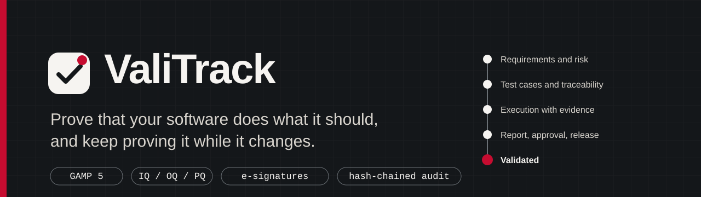

<br>

[](https://github.com/vladimirmilivojevic-creator/valitrack/actions/workflows/ci.yml)
[](LICENSE)


**[Live demo](https://valitrack.onrender.com)** &nbsp;·&nbsp;
**[Sign-in accounts](#try-it-in-60-seconds)** &nbsp;·&nbsp;
**[Screenshots](#screenshots)** &nbsp;·&nbsp;
**[How it works](#how-it-works)** &nbsp;·&nbsp;
**[Run it yourself](#run-it-yourself)**

</div>

> The live demo runs on a free server that sleeps at night (about 23:00 to 06:30 Vienna time) to stay inside the free hours.
> The first page after a pause can take up to a minute to open. After that it is fast. All data in it is invented.

---

## What is ValiTrack?

Companies that make medical devices must **prove** that the software they use for quality work does what it should,
and keep proving it after every update. That proof is a stack of documents: requirements, a risk assessment, tests with
results, a report, and signatures. In many companies it lives in Word files and spreadsheets.

ValiTrack keeps that proof in one place and **refuses to let a version go live while something is missing**.

- It manages the **validation lifecycle** of an application: GAMP 5 category, risk assessment, requirements, IQ/OQ/PQ tests with evidence, a traceability matrix and a PDF validation report.
- It runs **change control**: request, impact assessment by each department, approval with electronic signatures, testing, release.
- It keeps an **audit trail that nobody can edit**, even with a SQL console, and shows it when somebody tries.
- It tracks **user training per application version**, and supports the **users** with tickets and a configuration baseline.
- It answers questions with **SQL reports** that show their own SQL.

## Try it in 60 seconds

Open the [live demo](https://valitrack.onrender.com) and click a person. There is no registration.

| Click | Role | What this person can do |
|---|---|---|
| **Sophie Gruber** | Validation engineer | Writes requirements, tests and reports. Coordinates changes. Works the support tickets |
| **Eva Mayr** | QA manager | Reviews runs, approves tests, reports and changes, releases versions, closes deviations |
| **Lukas Hofer** | Tester | Executes tests and uploads evidence |
| **Nina Haas** | System owner | Second signature on high-risk changes |
| **Tim Steiner** | IT administrator | Users, tickets, configuration |
| **Paul Keller** | Auditor | Can look at everything and change nothing |

Three things to try first:

1. Open **DocuControl**. Version 3.3 is in validation, and the release gate says **in words** what is still open.
2. Open **Change control, CR-0001**. See what each department said, who signed, and which tests are planned.
3. Open **Audit trail** and press **Verify integrity**. Then open **SQL reports** and press **Show SQL**.

A ten-minute walkthrough is in [docs/demo-guide.md](docs/demo-guide.md).

## Screenshots

<table>
  <tr>
    <td width="50%"><b>Every application and where it is in its validation</b><br>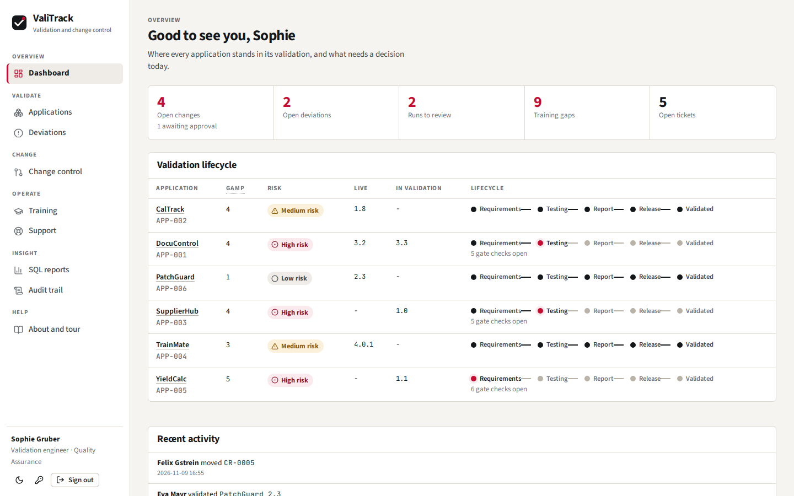</td>
    <td width="50%"><b>The release gate says why a version cannot go live</b><br>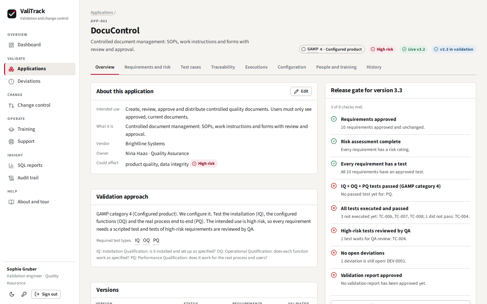</td>
  </tr>
  <tr>
    <td width="50%"><b>Risk assessment for each requirement</b><br>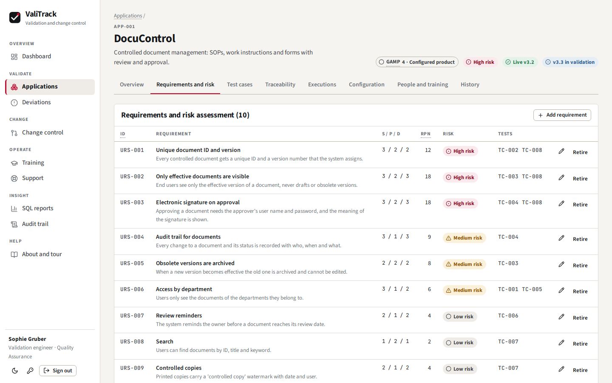</td>
    <td width="50%"><b>Traceability: requirement to test to result</b><br>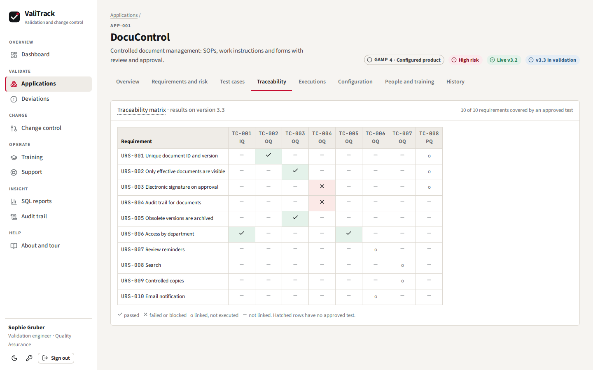</td>
  </tr>
  <tr>
    <td width="50%"><b>Test execution with evidence and a signature</b><br>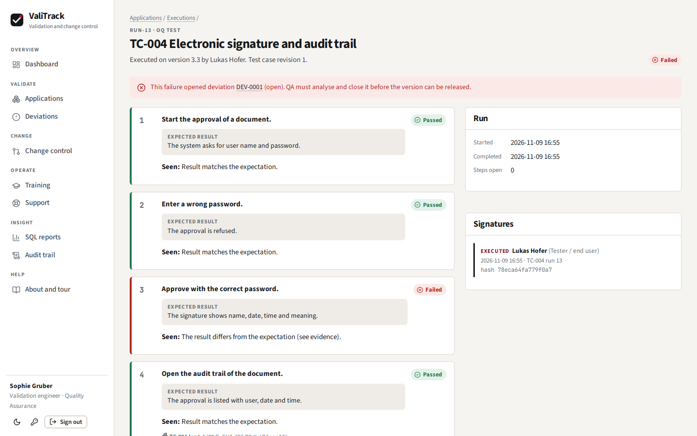</td>
    <td width="50%"><b>A change request from request to release</b><br>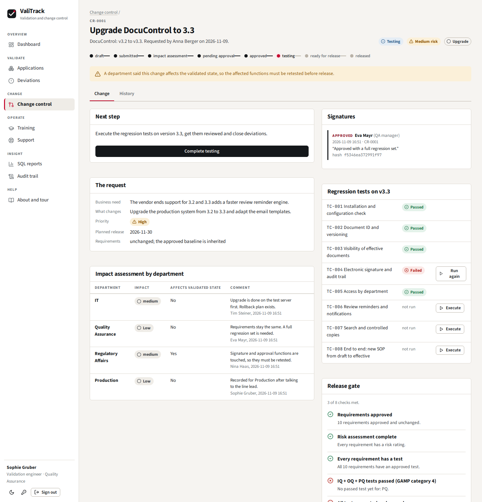</td>
  </tr>
  <tr>
    <td width="50%"><b>Training per application version</b><br>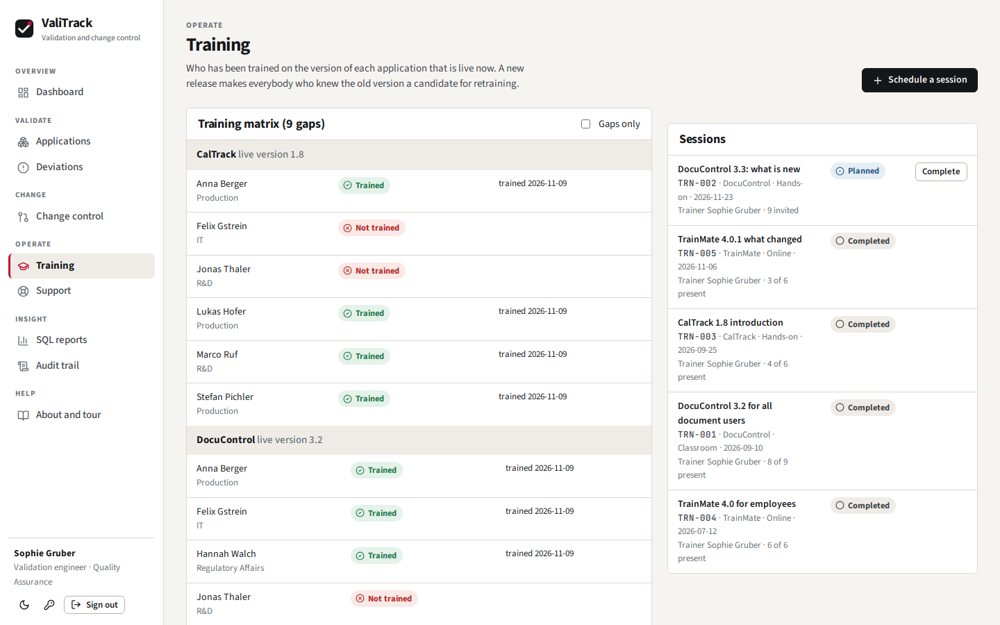</td>
    <td width="50%"><b>Reports are SQL views, and the SQL is shown</b><br>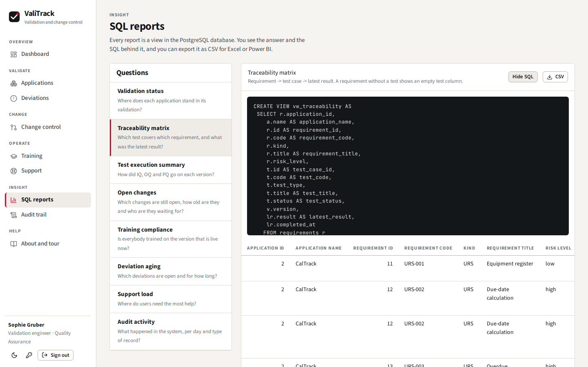</td>
  </tr>
  <tr>
    <td width="50%"><b>Audit trail with an integrity check</b><br>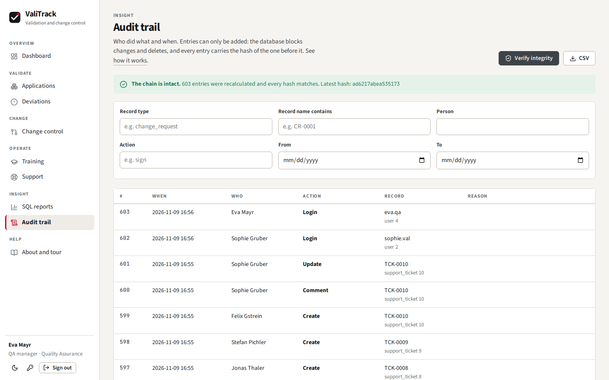</td>
    <td width="50%"><b>Light and dark theme</b><br>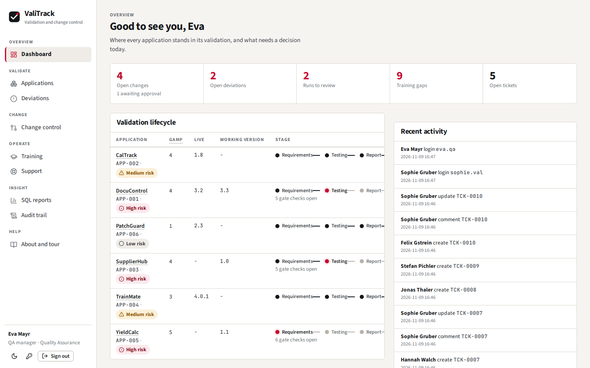</td>
  </tr>
</table>

## How it works

### A change to a validated application

No change happens "just like that". Every step has one rule about who may move it forward.

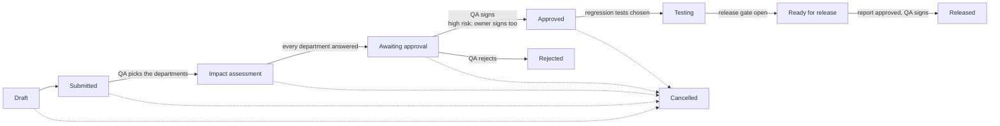

Releasing creates a new live version, marks the old one as superseded and asks everybody who was trained on the old version to be trained again.
The person who requested a change can never approve or release it.

### The release gate

A version can only be released when **all eight** checks are met. Each check explains itself, for example
*"3 of 12 requirements have no suitable approved test: URS-004, URS-005, URS-009."*

1. Requirements are approved, and unchanged since then
2. Every requirement has a risk rating
3. Every requirement has an approved test (scripted, unless the risk is low)
4. The test types that the GAMP category asks for have passed (category 4 needs IQ, OQ and PQ)
5. Every test was executed on this version and passed
6. Tests of high-risk requirements were reviewed by QA
7. No deviation is open
8. A report is approved **for exactly this state**. If a result changes later, the approved report becomes out of date

### Architecture

One container: the React app is built once and served by the FastAPI server. PostgreSQL holds the data and guards the rules.

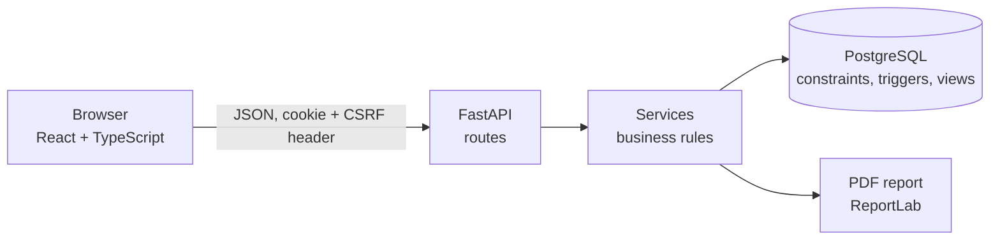

More detail in [docs/architecture.md](docs/architecture.md) and [docs/data-model.md](docs/data-model.md).

## Design choices worth a look

**The audit trail is enforced by the database, not by good behaviour.** Triggers block `UPDATE`, `DELETE` and `TRUNCATE`.
The server, not the application, writes time, sequence number and hash, and every row contains the hash of the previous one.
`SELECT * FROM verify_audit_chain();` recalculates the whole chain and names the first broken row. A test switches the trigger off,
edits an old row, and checks that the verifier finds it.

**A signature is linked to what was signed.** The signer types the password again. The system stores name, role, meaning, time,
and a hash of the record content, such as the exact bytes of the PDF report or every step result and evidence hash of a test run.

**Rules sit in the lowest layer that can enforce them.** The risk level is a generated column. Only one version of an application can be live because of a unique index.
Roles and permissions are one table in the code, and a test calls every changing route as the read-only auditor and expects a refusal for each.

**Segregation of duties is tested for every pair.** Author and approver, executor and reviewer, requester and approver, report author and approver.

**A health check that does not wake the database.** `/api/health` never queries PostgreSQL, so an uptime monitor can keep the free host awake
without using up the compute hours of a serverless database.

**Sample data goes through the same code as real data.** The demo is loaded by calling the services, so it has real signatures and a valid audit chain.

## Regulatory ideas and where they appear

ValiTrack is a demonstration designed around these ideas. It is not certified and has not been validated itself.
[docs/compliance-mapping.md](docs/compliance-mapping.md) lists them clause by clause, with what a real installation would still need.

| Idea | In ValiTrack |
|---|---|
| GAMP 5, risk-based validation, ISO 13485 4.1.6, FDA computer software assurance | GAMP category and a risk rating per requirement decide the tests. Unscripted testing is allowed for low risk only |
| 21 CFR Part 11 audit trail and electronic signatures | Hash-chained append-only audit trail. Signature with name, role, meaning, time and record hash |
| EU GMP Annex 11 change management | The change workflow. A validated configuration can only change under an approved change request |
| Traceability | Requirement, test case, run, evidence and signature are linked and shown in one matrix |
| Training records | Per person and per application version. A release triggers retraining |

## Run it yourself

```bash
docker compose up
# open http://localhost:8000 and click a demo account
```

Without Docker you need PostgreSQL 14 or newer, Python 3.12 and Node 22. Steps are in [docs/deployment.md](docs/deployment.md).

## Tests

More than 130 backend tests run against a real PostgreSQL, because triggers, views and generated columns are part of what is tested.
GitHub Actions also runs type checks, lint, unit tests, a production build, Playwright browser tests and a Docker build on every push.

```bash
cd backend && pip install -e ".[dev]" && pytest        # needs DATABASE_URL pointing to a database whose name contains "test"
cd frontend && npm ci && npm test && npx playwright test
```

## Technology

| | |
|---|---|
| Backend | Python 3.12, FastAPI, SQLAlchemy 2, Alembic, Pydantic, Argon2, ReportLab |
| Database | PostgreSQL 17 (Neon), SQL files for schema, triggers and views |
| Frontend | React 18, TypeScript, Vite, TanStack Query, hand-written CSS, no UI kit |
| Quality | Pytest, Vitest, Playwright, Ruff, ESLint, GitHub Actions |
| Hosting | Docker image on Render (free plan), Neon (free plan), uptime monitors |

## Limits

- It is a demo. A real installation would have to validate ValiTrack itself.
- Hardening that is described but not built: a database role without update and delete rights, an external time source,
  backups with restore tests, single sign-on. See [docs/deployment.md](docs/deployment.md).
- The hash chain shows that a row was changed or removed in the middle. Removing the newest rows can only be noticed
  by comparing the latest hash with a copy stored elsewhere.
- Free hosting means a slow first request after a long pause.

## License

The source code is public so that it can be read. It is **not** open source: copying, changing, sharing or using it in other projects is not allowed
without written permission. See [LICENSE](LICENSE).
