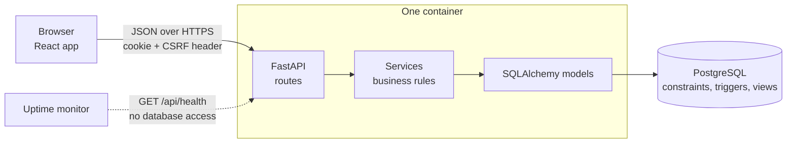

# Architecture

ValiTrack is one container with three parts: a React web app, a FastAPI server and a PostgreSQL database.
The web app is built once and served by the same FastAPI process, so there is one URL, no CORS and one thing to deploy.



## Where the rules live

The most important design choice: **a rule is enforced in the lowest layer that can enforce it.**

| Rule | Where it is enforced |
|---|---|
| Values are valid (status lists, ratings 1 to 3, one live version per application) | Database: `CHECK` constraints and a partial unique index |
| Risk level of a requirement | Database: generated column. A test compares it with the Python rule for all 27 combinations |
| The audit trail and signatures cannot be edited | Database: triggers that block `UPDATE`, `DELETE` and `TRUNCATE` |
| Time, sequence number and hash of an audit entry | Database: a `BEFORE INSERT` trigger. The application cannot choose them |
| Who may do what | `core/permissions.py`, one table, checked in every service function |
| Two people for two steps (segregation of duties) | Services, with a test for every pair |
| Is a version ready to be released? | `services/gate.py`, one function that returns a sentence per check |

Routes in `app/api/` are thin: parse the request, call a service, commit, build the JSON.
All business rules are in `app/services/`, one module per topic, and nothing in there knows about HTTP.

```
backend/
  app/
    api/         routes, request schemas, serializers
    services/    business rules (gate, changes, signatures, audit, runs, ...)
    models/      SQLAlchemy models, they mirror db/*.sql
    reports/     PDF generation (ReportLab), no database access
    seed/        demo data, loaded through the services
    core/        settings, security, permissions, database session
  db/            001_schema.sql, 002_audit_trail.sql, 003_report_views.sql
  alembic/       migrations that run those SQL files
  tests/         pytest, real PostgreSQL
frontend/
  src/pages/     one file per screen
  src/components shared pieces (signature dialog, release gate, status chip)
  src/lib/       API client, types, status labels, glossary
  e2e/           Playwright tests
```

## The audit trail

Every service that changes something calls `audit.record(...)`. The entries wait in the database session and
are written just before the commit, in the same transaction. A change and its audit entry succeed or fail together,
and a rolled-back change leaves no entry.

The table is append only and every row is chained to the previous one:

```sql
-- BEFORE INSERT trigger (simplified)
PERFORM pg_advisory_xact_lock(7270001);                       -- one writer at a time
SELECT seq, entry_hash INTO last_seq, last_hash FROM audit_log ORDER BY seq DESC LIMIT 1;
NEW.seq        := COALESCE(last_seq, 0) + 1;
NEW.prev_hash  := COALESCE(last_hash, repeat('0', 64));
NEW.occurred_at := clock_timestamp();                          -- server time, not client time
NEW.entry_hash := sha256(NEW.prev_hash || '|' || <the whole row as canonical JSON>);
```

`verify_audit_chain()` recalculates every hash and returns the first broken sequence number. Tests prove that:

- `UPDATE`, `DELETE` and `TRUNCATE` are refused;
- values sent by the application for time, sequence and hash are replaced;
- if someone with owner rights switches the trigger off and edits or deletes an old row, the verifier finds it.

Known limit: removing the newest rows cannot be seen from the chain alone. A real system keeps the latest hash somewhere else too.
The PDF report prints the chain head for that reason.

## Electronic signatures

`services/signatures.py` is the only place that creates a signature. It

1. checks that the role may sign with this meaning (`Reviewed`, `Approved`, `Released`, ...);
2. checks the password again, and counts a wrong password towards the lockout;
3. stores name, role, meaning, the record, and the **hash of the record content** at that moment;
4. lets the database stamp the time and the signature hash. The table cannot be changed afterwards.

What is hashed depends on the record: the requirements baseline, the steps and results of a run (including the
SHA-256 of every evidence file), the exact bytes of the PDF report, or the change request with its impact assessments.

## Release gate

`evaluate_release_gate(db, version_id)` returns eight checks, each with a plain sentence:

1. requirements approved, and unchanged since (a hash of the baseline is stored at approval);
2. every requirement has a risk rating;
3. every requirement has an approved test, scripted unless the risk is low;
4. the test types that the GAMP category asks for exist and passed;
5. every test was executed on this version and passed;
6. tests of high-risk requirements were reviewed by QA;
7. no deviation is open;
8. a validation report is approved **for exactly this state** (a hash of baseline, results and deviations).

If anything changes after the report was approved, check 8 fails again. This is the part that makes a report trustworthy.

## Security

- Passwords: Argon2id with the OWASP minimum parameters. Lockout after five wrong passwords.
- Sessions: JWT in an `HttpOnly`, `SameSite=Lax` cookie, 30 minutes, refreshed while the user is active.
- CSRF: every changing request must send the `X-CSRF-Token` of the session. A test walks through **every route**
  and checks that it refuses requests without a login, and that the read-only auditor cannot change anything.
- Evidence files: only PNG, JPEG, PDF or text, up to 2 MB, served with `nosniff` and a sandbox CSP.
- Security headers on every response, `no-store` on the API.

## Why PostgreSQL features instead of application code?

Because the rules that protect records should not depend on every developer remembering them.
A constraint, a generated column or a trigger also protects against a bug in the next feature, and against a person with a SQL console.
The trade-off is that the schema is plain SQL (`backend/db/*.sql`) and the SQLAlchemy models must mirror it. The test suite builds the database from the real migrations, so a mismatch fails at once.

## Decisions

| Decision | Reason |
|---|---|
| Synchronous SQLAlchemy | Easier to read and to explain. The load is small. |
| SQL files run by Alembic, not autogenerated migrations | Triggers, generated columns and views are the point of the design. |
| Hand-written CSS with design tokens, no UI kit | The screens look like controlled documents, not like a generic dashboard. |
| Evidence and PDFs in the database | The free host has no disk. The hash is stored next to the bytes. |
| `/api/health` never touches the database | A monitor that pings the database every few minutes would keep a serverless database awake all day. |
| Demo data loaded through the services | The sample data has real signatures and a valid audit chain. |

## Testing

- **Backend:** about 150 tests on a real PostgreSQL (triggers, views and generated columns are part of what is tested).
  Rules, audit trail, signatures, release gate, change control, permissions of every route, PDF content, SQL reports, demo data.
- **Frontend:** type check, lint, unit tests for the formatting rules, the API client and the signature dialog.
- **End to end:** Playwright drives the real app: sign in, run a test, sign, review as a second person, verify the audit trail.
