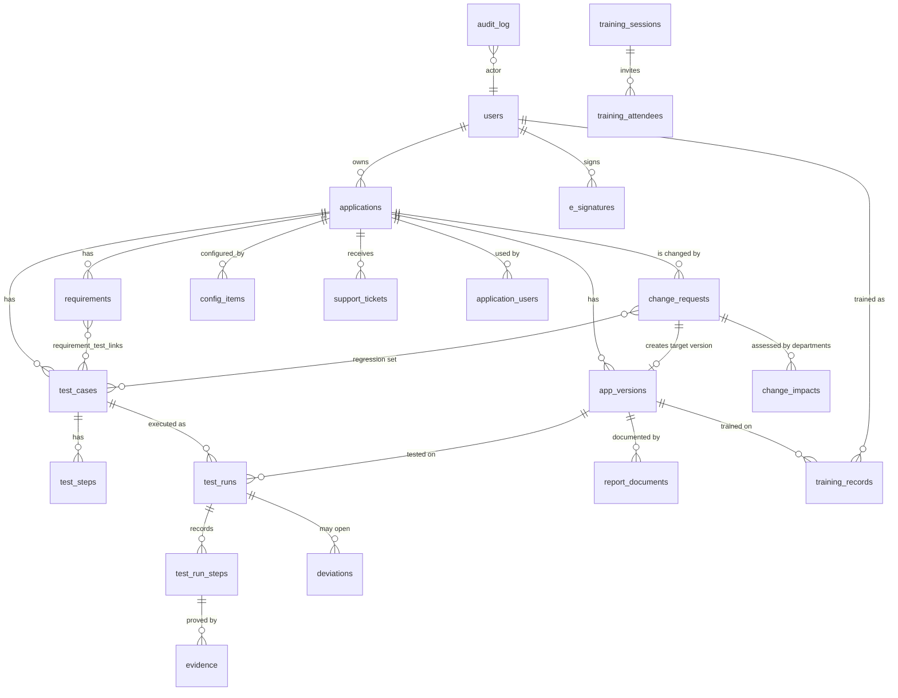

# Data model

The schema is plain SQL in `backend/db/`. The diagram shows the main tables and how they connect.



## What the database guards by itself

| Object | Rule |
|---|---|
| `applications.risk_class` | Generated from three impact flags (patient safety, product quality, data integrity) |
| `requirements.rpn`, `risk_level` | Generated: severity x probability x detectability. 12 or more is high, 6 to 11 medium, below 6 low |
| `app_versions` | Partial unique index: at most one `validated` version per application |
| `requirements` | An FS must have a parent URS, a URS must not |
| `test_runs` | `status = 'completed'` if and only if `result` is set |
| `evidence` | At most 2 MB, SHA-256 stored with the bytes |
| `audit_log` | Append only. A trigger sets sequence, time, previous hash and entry hash |
| `e_signatures` | Append only. A trigger sets time and signature hash |
| Codes (`CR-0001`, `DEV-0001`, `TCK-0001`) | Sequences owned by the column, so the demo reset restarts them |

## The report views

Each report on the *SQL reports* page is a view. The page shows the view definition next to the result.

| View | Question it answers |
|---|---|
| `vw_validation_status` | Where does each application stand? Coverage, passed, failed, not run, open deviations |
| `vw_traceability` | Which test covers which requirement, and the latest result |
| `vw_test_execution_summary` | How did IQ, OQ and PQ go on each version? |
| `vw_open_changes` | Which changes are open, how old, and who are they waiting for? |
| `vw_training_compliance` | Is everybody trained on the live version? |
| `vw_deviation_aging` | Which deviations are open, and for how long? |
| `vw_support_by_application` | Where do users need the most help? |
| `vw_audit_activity` | What happened per day and type of record? |

`vw_latest_runs` is a helper view (the latest completed run of each test on each version) that the others build on.

## Example queries

```sql
-- Requirements that no approved test covers
SELECT r.code, r.title, r.risk_level
FROM requirements r
WHERE r.status = 'active'
  AND NOT EXISTS (
        SELECT 1 FROM requirement_test_links l
        JOIN test_cases t ON t.id = l.test_case_id AND t.status = 'approved'
        WHERE l.requirement_id = r.id);

-- Is the audit trail intact?
SELECT * FROM verify_audit_chain();

-- Who signed what, newest first
SELECT signed_at, signer_name, meaning, entity_label FROM e_signatures ORDER BY id DESC LIMIT 20;
```
